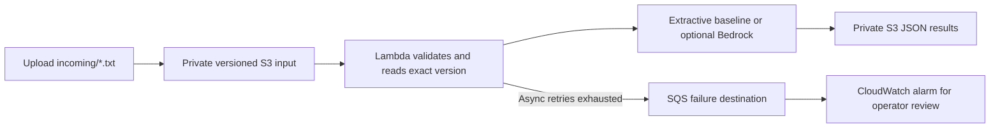

# AWS AI Document Pipeline

Turn small text documents into structured summaries using a private, event-driven AWS pipeline. Run the document processor locally without AWS, then optionally deploy S3 → Lambda → S3 with Bedrock generation.

**Status:** local processor and S3 adapter tested with fake clients. AWS deployment, IAM behavior, and live Bedrock inference have not been verified. Infrastructure is supplied as AWS SAM source, not as a claim of a running service.

## Local demo

Requires Python 3.11+. No dependencies or credentials needed for these commands:

```bash
python src/processor.py samples/incident.txt
python -m unittest discover -s tests -v
```

Local mode returns the first three sentences, capped at 1,200 characters. It is an extractive baseline, not an LLM. The output also contains a SHA-256 digest, byte count, and word count.



## What this demonstrates

- Version-aware event processing: the handler reads the version referenced in the event, so an overwrite cannot silently change the document being processed.
- Deterministic output key per bucket/key/version; retries replace the same result. This is **not exactly-once execution**: duplicate deliveries may repeat inference and charges, and simultaneous model outputs may differ.
- Separate input/output buckets avoid recursive triggers; prefix and suffix filters restrict accepted events.
- UTF-8 validation and a 32 KiB byte limit before inference; bounded stream reads protect the worker even when event metadata is inaccurate.
- IAM limited to input version reads, output writes, and the selected model; private encrypted buckets, TLS policies, limited concurrency, retained buckets, and short log retention.
- Failed invocations go to an encrypted SQS destination after configured asynchronous retry handling. There is an alarm but no notification subscription or automatic redrive.

## Optional AWS deployment

Requires AWS CLI, SAM CLI, Docker for SAM build, and a sandbox AWS account with deployment permissions. AWS services can incur charges. Review the template first and set a budget in your account. This repository does not deploy automatically from CI.

```bash
sam validate --lint
sam build --use-container
sam deploy --guided
```

Leave `BedrockModelId` and `BedrockModelArn` empty for the extractive baseline. To enable AI, set both to a compatible regional foundation model ID and its exact ARN. The template deliberately supports a single regional model; cross-region inference profiles need extra IAM resources and are outside this demo.

Get `InputBucketName` and `OutputBucketName` from stack outputs, then upload only synthetic text:

```bash
aws s3 cp samples/incident.txt s3://YOUR_INPUT_BUCKET/incoming/incident.txt
aws s3 ls s3://YOUR_OUTPUT_BUCKET/results/
aws s3 cp s3://YOUR_OUTPUT_BUCKET/results/YOUR_RESULT_KEY.json -
```

Allow for asynchronous event processing. Inspect the Lambda logs and failure queue if no result appears. Do not upload confidential documents: enabling Bedrock sends document content to the configured AWS model. Prompt instructions reduce but do not eliminate hallucination and prompt injection risks. Summaries require human review.

## Failure handling and cleanup

Malformed or oversized files fail validation, retry, then reach the failure destination; inspect the invocation record, correct the input, and upload a new version. No automatic redrive is configured. Throttled events can age out; concurrency is limited to two workers for a small demo.

Run `sam delete` when finished. Both data buckets use `DeletionPolicy: Retain` and remain after stack deletion. Lifecycle rules expire demo objects after seven days; noncurrent input versions expire after one day. Inspect and remove retained buckets and any SAM-managed build artifacts yourself when no longer needed. Review the failure queue before deleting the stack because queue deletion removes its messages. Log groups and other non-retained resources are removed with the stack.

## Interview walkthrough

1. Process the synthetic incident locally and explain the baseline.
2. Run tests covering duplicate events, overwritten versions, malformed documents, and write failures.
3. Trace each permission in the template to the operation that requires it.
4. Discuss a stronger design using SQS buffering, conditional idempotency records, per-document status, DLQ redrive, and labeled summary evaluation.

Do not claim deployment, throughput, cost savings, or production ownership until you have measured them yourself.

## References

- [SAM S3 event sources](https://docs.aws.amazon.com/serverless-application-model/latest/developerguide/sam-property-function-s3.html)
- [Bedrock Converse](https://docs.aws.amazon.com/bedrock/latest/userguide/conversation-inference.html)
